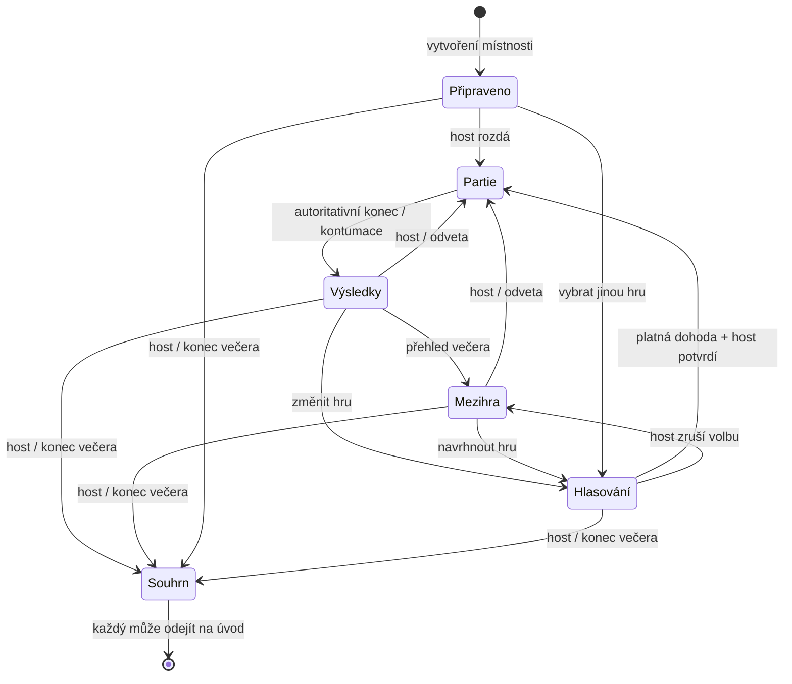

# Herní večer · W3

## Audit před implementací

W2 má jeden room lifecycle ve dvou adaptérech: Node `RoomManager` s WS/timerem
a přenositelný `RoomApplication` nad repository (Supabase). Herní stav a `seq`
patří do existujícího room JSON. `round` roste napříč odvetami. Prší/Sedma
mají oddělené čisté enginy a soukromé projekce. Lobby, rematch, boty, emotes,
BLIK a identita už jsou společné. Výhry se dosud sčítaly při dokončení engine,
ale chyběla historie, hlasování a ochrana relace mezi partiemi.

Nezavádíme další room ani transport. Přidáváme sdílený čistý session modul
`shared/evening.ts`: záznam rozpracované partie (pouze veřejné identity),
ledger výsledků, statistiky a volební pravidla. Aktivní engine zůstává v
`room.game`; jeho raw karty do session view nevstoupí.

## Přechody



Výsledky mají hotový engine kvůli dohrání animací. Explicitní přechod do mezihry,
hlasování nebo souhrnu engine odstraní a zruší botí deadline/timer. Kód,
identity, sedadla, sekvence a ledger zůstávají. Nové rozdání zvýší `round` i `seq`;
staré tahy nemohou zasáhnout novou partii.

## Dohoda a souběh

- Hlasují připojení lidé, každý jednou s možností změny. Boti nehlasují.
- Nadpoloviční většina všech způsobilých lidí určí kandidáta. Bez většiny
  musí nejdřív hlasovat všichni; potom rozhoduje nejvyšší počet hlasů, při
  shodě host vybere jednu z vedoucích her. Vždy následuje potvrzení hostem.
- Každé hlasování má `ballotId`. Souběžné hlasy různých lidí se přijímají
  v rámci stejné volby; staré hlasy z předchozí volby se odmítnou.
- Potvrzení/přechody nesou `baseRevision`. Změna hlasů či přítomnosti rozhodnutí
  zneplatní, host musí použít čerstvý stav. Supabase používá existující CAS a
  request receipts; Node má sériové zpracování a stejná čistá pravidla.
- Odpojený/odchozí ztratí hlas, nový člověk hlasuje sám. Neplatné hlasy pro
  Sedmu při třech připojených se odstraní. Žádná automatická hra ve třech:
  lze zvolit Prší, přidat/odebrat bota, počkat na návrat/uvolnění místa.
- Nová partie vyžaduje všechna obsazená místa připojená; držíme je do původní
  ochranné lhůty, aby přepnutí nepřeházelo sedadla. Host přechází na dalšího
  dostupného člověka podle původního vzoru.
- `start`/`rematch`/legacy `lobby` i změny botů podporují `round`; nové UI ho vždy posílá.
  Duplicitní start během partie nic neudělá; opožděný příkaz z jiné partie
  je stale. Zavřený večer už nejde rozehrát.

## Skóre a historie

Každá dokončená partie má monotónní id (`round`), snímek účastníků/týmů a
serverový výsledek. Ledger ji přijme právě jednou. Hráčům se přičte odehraná
partie, vítězům jedna výhra; ve 2v2 oběma vítězným partnerům také týmová výhra.
Remíza nikomu výhru nepřidá. Série vlastních po sobě odehraných partií se při prohře/remíze přeruší. Kontumace
se počítá jako výsledek a je viditelně označená.

Odchozí zůstává ve scoreboardu a historii; nová identita začíná od nuly.
Původní reconnect token/UUID zachová statistiky i po explicitním odchodu, dokud otevřená místnost stále existuje. Hostitelská práva se tím nevracejí. Do odehraných se počítají jen
účastníci při zahájení, ne hosté příchozí po konci. Body Sedmy se nesčítají s
výhrami Prší. Detail uchová oba týmové součty. Timeline uchová posledních 100
partií; agregáty a nejhranější hry zůstávají přesné za celý večer.

Supabase využije stávající persistenci room JSON bez nové SQL tabulky či
migrace. Node relace nepřežije restart procesu; opuštěná Supabase místnost se
maže podle stávajícího cleanupu. Skončení večera zachová souhrn, dokud existuje
místnost. Starší místnosti začnou ledgerem až od aktualizace; staré výhry se
nezamění za vymyšlené záznamy. Převzatá běžící partie nemá známý čas začátku.

## Přechod a QA

Přechodový BLIK je krátký a přerušitelný, reduced motion ho přeskočí. Animace
neřídí start ani jiné pravidlo. Veškeré značkové efekty starého stolu se ruší
unmountem/resetem, emotes fungují i v mezihře a souhrnu.

Automatické ověření:

- 123 testů včetně regresí Prší/Sedmy, ledgeru, majority/shody, konkurenčních
  hlasů, stale voleb/příkazů, vrácené/nové identity, zachování odchozích,
  týmových výher, remízy, okna historie, obnovy hostitele a botího timeru.
- Tři střídající se celé partie ve stejné místnosti přes skutečný WebSocket;
  reconnect ve hlasování, soukromé ruce, přesný ledger a závěrečný souhrn.
- Totéž přes skutečný lokální Supabase Auth/JWT, Edge Function, Postgres/RLS,
  Realtime a přímo frontendový `SupabaseTransport`; také existující Prší a
  Sedma 1v1/2v2 smoke a idempotence. `npm run qa:supabase`.
- Typecheck, produkční build webu/Node, build webu pro Supabase, Edge bundle a
  `git diff --check`. Samostatný lint příkaz v repozitáři není.
- SSR ověření skutečných UI komponent pro mezihru, hlasování, nedostupnou Sedmu,
  scoreboard, rozkliknutelnou historii a souhrn. To není vizuální QA.

Pro povolené prostředí je připravený `npm run qa:evening` (vedle běžícího
`npm run dev`), případně `REDUCED=1 npm run qa:evening`: UI odehraje tři hry
s desktopem a dotykovým telefonem, obnoví stránku při volbě a uloží PNG do
`output/playwright/evening`. Tento prohlížečový skript zde nebyl spuštěn.
Chybí tedy živá kontrola desktopu/mobilu, screenshoty a ruční ovládání/audio.

 Vizuální přístup k localhostu byl
v minulé vlně uloženou bezpečnostní politikou zamítnut; bez změny tohoto
nastavení se nepokoušíme o další prohlížečovou cestu.

## Nasazení W3

Bez nové SQL migrace a bez nových proměnných. Nasaď web i nově sestavenou
funkci `game`, klienty pak obnov:

```sh
npm ci
npm run build:supabase
npx supabase functions deploy game
```

Před nasazením je vhodné dohrát současné partie. Starý frontend nezná nové
mezihry a volby; staré příkazy bez epochy zůstávají kvůli kompatibilitě přijímané,
nový frontend ji vždy posílá. W4/W5 nejsou součástí změny.
