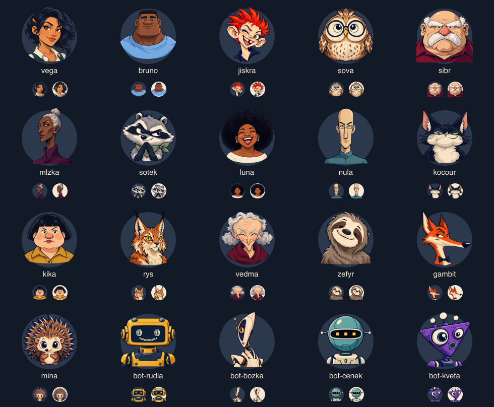

# BALÍK — postavy a stav hráče

První pack má **16 hráčských postav a 4 roboty**. Vega je zachovaná první postava;
ostatní byly nově navržené samostatně, bez její tváře jako obrazové reference.
Rozdíly stojí na anatomii, věku, výrazu a siluetě: široký Šíbr, vysoká Mlžka,
hranatý Bruno, kulatá Sova, dlouhý liščí profil nebo trojúhelníkový robot.
Rukopis spojuje tmavá kontura, velké tvary a krémové akcenty. Identita není
navázaná na Stormpunk, Retro Arcade ani konkrétní hru.



## Assety a původ

- `packages/web/public/avatars/*.webp`: finální průhledné portréty, 192 × 192 px,
  přibližně 243 kB celkem. Zdrojové PNG zůstávají v adresáři generovaných obrázků.
- Všechny portréty vznikly vestavěným **image_gen**, nikoli náhradním API/CLI.
- [Přesné prompty a zdrojová jména souborů](avatar-prompts.json).
- Přehled v aplikaci: `/dev/avatars` při `npm run dev`. Obsahuje výběr, všechny
  stavy, rozměry 24–96 px a přepínač omezeného pohybu. Do místnosti nic neposílá.

Portrét zahrnuje hlavu, obličej a případný doplněk. Barevný disk, ring, badge,
kartičky a reakční kotva jsou samostatné HTML/CSS vrstvy. Změna ilustrace tak
nevyžaduje překreslení stavů. Iniciála je pouze fallback při chybě načtení assetu;
neznámé staré id dostane stabilní výchozí postavu z veřejného id hráče.

## Architektura

- `shared/src/avatars.ts`: whitelist veřejných id a stabilní fallback. Bez assetů,
  Reactu, SDK a pravidel hry.
- `web/src/avatars/catalog.ts`: id, jméno, typ, asset, barva, tagy, odemčení.
  Vše je odemčené. Robotí portrét si může vybrat i člověk; **badge počítače vychází
  ze skutečného serverového `bot`**, nikoli z obrázku.
- `Avatar.tsx`: portrét, `AvatarStatusRing`, `AvatarThinkingState`, badge
  a volitelná reakční kotva. Podpora idle/self/thinking, offline, ready, winner,
  danger; barvy edice do komponenty nevstupují.
- `AvatarPicker.tsx`: nativní modální dialog v nastavení na úvodu, v lobby,
  během hry i v přehledu večera. Výběr je uložený jako `balik.avatar` lokálně.
  Nový prohlížeč dostane náhodnou hráčskou postavu; ruční volba ji nahradí.
- `status.ts`: stav tahu se odvozuje pouze z veřejného, aktuálního serverového
  `currentPlayerId`, fáze a přítomnosti. Nikdy z ruky soupeře, plánů bota nebo
  pravdivosti tvrzení ve Lháři. Potvrzený tah vypne thinking předchozího hráče,
  i když animace karet ještě doběhne. Odpojení či konec partie vypnou thinking.

Thinking jsou tři malé **neutrální ruby BALÍKu**, jemně levitující nad portrétem.
Vlastní hráč má ring a „Jsi na tahu“, soupeř ring, kartičky a „Přemýšlí…“.
Kartičky zůstávají připojené a při změně stavu zhasnou přes opacity; neposílají
žádné herní příkazy a neřídí čas tahu. Při systémovém nebo aplikačním omezení
pohybu jsou statické. Reakce dál používají existující veřejné emote události.

## Přenos a kompatibilita

`RoomPlayerView.avatarId` je volitelné kvůli starým místnostem. Příkazy `create`
a `join` mohou přinést `avatarId`; `profile { avatarId }` mění pouze vlastní místo
ověřené spojením nebo přihlášením. Nepřijímá URL ani cílové id jiného hráče.

Node WebSocket i přenositelná Supabase aplikace ukládají tutéž kosmetickou
hodnotu a posílají ji všem ve filtrovaném room view. Profilová změna neposouvá
herní `seq`, nemění karty, hlasování ani botí deadline. Reconnect bez nového id
zachová uloženou postavu; frontend při reconnectu pošle poslední lokální volbu,
takže se přenese i výběr provedený během výpadku. Přenos Supabase příkazy řadí.

Soukromé části hry dál procházejí existujícími `viewFor`/`filterEventFor`.
Kosmetika nepřidává tabulku, bucket, účet, placené odemykání ani závislost
na úložišti obrázků Supabase.

## Nasazení

Nasadit **frontend i backend** kvůli novému příkazu a `avatarId` v room views.
Pro Vercel + Supabase:

```sh
npm run build:supabase
supabase functions deploy game --project-ref <project-ref>
```

Vercel sestaví frontend po merge. SQL migrace, proměnné prostředí a Storage
bucket se nemění. Po nasazení obnovit staré herní taby. Při provozu Node backendu
nasadit také novou verzi serveru.

Veřejná galerie karet Retro Arcade je na **`/decks/retro-arcade`**, s odkazem
na úvodu, filtrem čtyř barev, 32 skutečnými kartami, detaily, rubem, malým
náhledem, světlou deskou a ukázkou stickerů. Vercel rewrite dovoluje přímé
otevření URL. Galerie je dostupná i v produkci; avatar playground je vývojový.

## Ověření a rozšíření

Testy ověřují oba backendy, vlastnictví profilu, validaci id, reconnect,
nezměněný herní stav/seq/hlasování/deadline a soukromí rukou. Web testy ověřují
celý katalog, alpha a velikost WebP, vrstvu thinking, nezávislost na edici,
výběr a veřejnou Arcade galerii. `npm run qa:supabase` používá skutečný lokální
Auth, Edge funkci, Realtime a klientský transport včetně změny postavy mezi
dvěma lidmi během partie a obnovení spojení.

Statický přehled portrétů byl zkontrolovaný na tmavém i světlém disku při 30 px
a ve větším náhledu. **Vizuální kontrola běžícího UI na desktopu/mobilu zatím
chybí:** uložené zamítnutí přístupu prohlížeče k localhostu ji blokuje. Statický
přehled a SSR testy tuto kontrolu nenahrazují.

Další pack přidá id do společného whitelistu, metadata do katalogu a průhledný
asset do stejného adresáře. Stavy, picker a hry se nemění. Příští praktický krok
je vytvořit druhou výrazovou variantu u vybraných postav a přepínat pouze
portrét podle veřejného stavu; případná profilová služba může později nahradit
lokální preference bez změny herních enginů.
