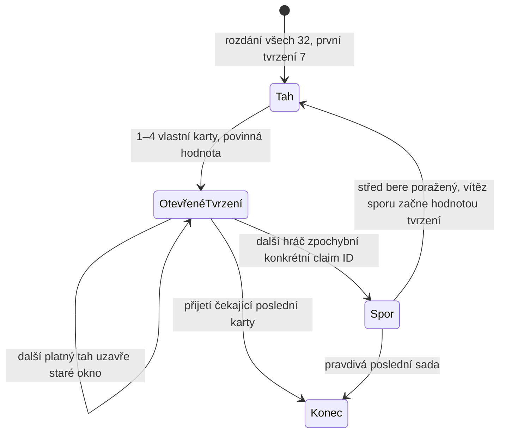

# Lhář — pravidla digitální varianty BALÍK (W5)

## Audit a hranice

Společný dispatcher `shared/games.ts` už odděluje Prší a Sedmu. Oba backendy
používají stejná pravidla a filtr událostí, `baseSeq` odmítá opožděný tah; portable
backend navíc ukládá request receipts a používá optimistic CAS. Room/session,
připojení, identita, emotes a výsledkovka se znovu použijí. Lhář má vlastní čistý
engine, view a eventy. UI přidává vlastní display/director nad společným CardLayer,
geometry a registry kosmetických témat. Značka BALÍK a zvukové recepty se nemění.

## Jedna přesná varianta

- 2–4 hráči, francouzských 32 karet 7,8,9,10,J,Q,K,A. Barva nemá význam.
- Vše se rozdá po jedné od začínajícího. Ve dvou 16/16, ve třech 11/11/10,
  ve čtyřech 8/8/8/8. Větší ruce mají první dvě místa od začínajícího. Odveta
  posouvá začínající místo jako ostatní hry platformy. Žádná karta neleží stranou.
- První povinné tvrzení je 7. Každý platný skrytý tah je 1–4 různé karty z vlastní
  ruky a přesně požadovaná hodnota; po něm hodnota cyklí 7→8→9→10→J→Q→K→A→7.
  Skutečné hodnoty mohou být libovolné. Server před výzvou pravdivost nevyhodnocuje.
- Pouze bezprostředně následující hráč může zpochybnit poslední sadu. Ostatní čekají.
  Pokud položí vlastní platný tah, předchozí okno se atomicky zavře. Neplatný tah
  okno nezavře. Není zde časový limit ani závod s animací.
- Výzva nese ID tvrzení. Server ukáže právě jeho 1–4 karty. Všechny musí odpovídat
  deklarované hodnotě. Při lži bere celý střed autor tvrzení; při pravdě vyzyvatel.
  Starší skryté sady se nikomu dalšímu neodhalují. Příjemce dostane identitu všech
  dobraných karet soukromě, ostatní jen počet.
- Po sporu začíná **hodnotou napadeného tvrzení** hráč, který střed nebral: při odhalené lži vyzyvatel,
  při pravdivém tvrzení jeho autor. Střed i aktuální tvrzení se vyprázdní. Další běžné tahy opět postupují cyklem 7–A.
  Tato startovní hodnota je záměrná: zátěžové testy ukázaly velmi dlouhé cykly
  při návratu vždy na 7 ve dvou hráčích; návrat na napadenou hodnotu je jednoznačný
  a v testech 50 různých seedů pro každý počet hráčů odstranil tento problém.
- Prázdná ruka autora posledního tvrzení je pouze **čekající výhra**. Další hráč
  může dát výzvu, nebo výslovně **Věřím · potvrdit výhru**. Nemůže v tomto stavu
  zahrát další sadu. Pravdivá poslední sada vyhraje po výzvě, přijatá vyhraje bez
  odhalení; lež vrací střed autorovi a hra pokračuje.
- Pro běžný tah je **Věřím / Pokračovat** skutečným odesláním vybraných 1–4 karet,
  nikoli tlačítkem, které by samo neprovedlo tah.
- Výhra = jeden vyhraný zápas do Herního večera, žádné karetní body. Odveta
  vyčistí všechna tvrzení/odhalení. Lze následně hlasovat o Prší/Sedmě/Lháři.
- Odpojení rezervuje místo podle společného grace period. Při skutečném odchodu
  nebo vypršení místa se partie ukončí kontumačně: ve dvou vyhraje zbývající hráč;
  ve třech/čtyřech bez vítěze (nelze spravedlivě určit jediného). Žádný skrytý tah
  se tím nezmění v běžnou výhru odcházejícího. Stav karet zůstává pro audit kompletní.

## Veřejné a soukromé informace

`LharState` smí existovat jen na autoritativním serveru. `lharViewFor` konstruuje
whitelist: cizí ruka = počet, střed = počet, tvrzení = monotónní ID/autor/hodnota/počet.
Vlastní ruka je soukromá. Poslední odhalení obsahuje jen napadenou sadu; stručná
historie posledních 12 tvrzení neobsahuje karty ani nezjištěnou pravdivost.

Události:

- `lharStarted`: klient dostane jen vlastní rozdané karty a veřejné pořadí rozdání.
- `lharPlayed`: všichni autor/počet/deklarace/ID; pouze autor navíc vlastní karty.
- `lharResolved`: veřejně jen poslední napadená sada, výsledek, příjemce a počet středu.
- `lharTaken`: všichni počet/příjemce/ID, jen příjemce má soukromé karty.
- `lharTurn`: aktuální hráč a požadovaná hodnota; `lharEnded`: ověřený výsledek.

Pravdivost skrytého tahu není v public view, reconnect snapshotu, veřejné historii,
názvu assetu ani veřejném animačním payloadu. Ruby používají `card:null`; soupeřovy
položené karty mají pouze lokálně vytvořené klíče nezávislé na skutečných identitách.
Filtr i snapshot mají samostatné testy. Logy klientovi neposílají tajný stav.

## Souběh a bot

Počet/vlastnictví/unikátnost/hodnota/tah/fáze se ověří před mutací. `baseSeq` a CAS
rozhodnou souběh play vs challenge: první platný commit vyhraje, druhý je stale.
Výzva/přijetí navíc musí mít ID právě otevřeného tvrzení. Duplicitní HTTP request
vrací receipt, nový request se starou sekvencí stav nezmění. Server nečeká na UI.

Bot dostává `LharView`, nikoli raw state. Hraje pravdivou skupinu, pokud ji má;
jinak zkusí skupinu jiné hodnoty. Výzvu dává při veřejně dokazatelné nemožnosti
(tvrzený počet + vlastní karty stejné hodnoty > 4), u čekající výhry častěji (65 %, jinak ji přijme), jinak s 28%
pravděpodobností. Bluf vybere náhodnou skupinu a omezuje ji na 1–2 karty. Nezkoumá střed ani cizí ruce a nemá lookup tajných karet.

## Tok výzvy

## Implementace a ověření

- `shared/lhar`: pure engine, whitelist public/private view a bot nad hráčským view.
- `web/lhar`: server-event display/director, společný stabilní CardLayer a oddělený
  výběrový dialog. Ten má velké textové/SVG cíle i pro plnou 32kartovou ruku.
- Reconnect zruší frontu a časovače, nepřehrává staré odhalení. Kontrola round/seq
  odmítá staré snapshoty i při reset flagu a při díře/duplicitě obnoví snapshot.
  Reveal se navíc aplikuje pouze na odpovídající ID tvrzení a počet karet poslední sady.
- Reduced motion odstraní dramatickou pauzu a pohyb, ale ponechá čitelný statický
  verdikt. Poslední odhalení a příjemce zůstávají dohledatelní ve veřejné historii.
- Testy pravidel zahrnují 150 plných deterministických botích her (50 seedů pro
  2/3/4 hráče), zachování všech karet, obě pravdivosti, poslední kartu a odchod.
- Portable backend testuje duplicitní request receipts, souběh play/challenge přes CAS,
  nové worker instance, přesné skóre, bot wakeup, odvetu a přechod do Sedmy.
- Skutečné WebSocket scénáře: 2/3 klienti, výzva, redakce všech zpráv, reconnect,
  dokončená partie a odveta. Regrese Prší/Sedma/večera zůstávají zelené.
- Skutečný lokální Supabase: Auth/JWT/RLS/Realtime a frontend transport; 2 i 3
  hráči dohrají Lháře, reconnectnou v otevřeném okně, odhalí poslední sadu a poté
  v téže místnosti se stejnou identitou přejdou hlasováním do Prší.
- Obě kosmetické edice + Klasika fungují ve společném CardView. U Klasiky Lhář
  nevykresluje akční nápovědy Prší (+2/stop/barva). Přepnutí vzhledu po každém
  tahu nezmění úplnou posloupnost akcí ani výsledek partie.

**Neprovedeno: živé prohlížečové QA.** Uložené pravidlo přístupu v prostředí blokuje
lokální herní URL. Neobcházíme je jiným browserem nebo screenshotovým nástrojem.
Proto zde nejsou screenshoty/video sekvence vydávané za ověřený výsledek.
`npm run qa:lhar` je připravený scénář pro povolený Chrome: desktop + touch mobil,
onboarding, rozdílné edice, položení → rozhodnutí → odhalení → příjemce, reconnect,
celá partie a pokračování do Prší. `REDUCED=1 npm run qa:lhar` opakuje průchod bez
pohybu. Tato browserová skripta zde nebyla spuštěna; PR zůstává draft do vizuální QA.

## Nasazení W5

1. Sloučit PR a nechat Vercel sestavit frontend s existujícím nastavením Supabase.
2. Sestavit aktuální backend: `npm ci && npm run build:supabase`.
3. Nasadit **funkci `game`** do stejného Supabase projektu:
   `supabase functions deploy game --project-ref <project-ref>`.
4. Obnovit otevřené klientské taby, aby všechny měly UI a protokol s Lhářem.

**Žádná SQL migrace ani nové environment proměnné.** Starší uložené večery získají
nulový agregát Lháře při načtení; předchozí partie a výsledky se nedopočítávají.
Při vlastním Node hostingu je potřeba nasadit i nový Node server. Samotný deploy
frontendu nepřidá pravidla do dříve nasazené Edge funkce.

Závěrečná lokální kontrola W5: **161 testů / 19 souborů**, typecheck, web/Node build,
Supabase varianta webu i Edge bundle prošly. Lokální Supabase QA doběhla úspěšně;
browserová kontrola výše zůstává neprovedená.
